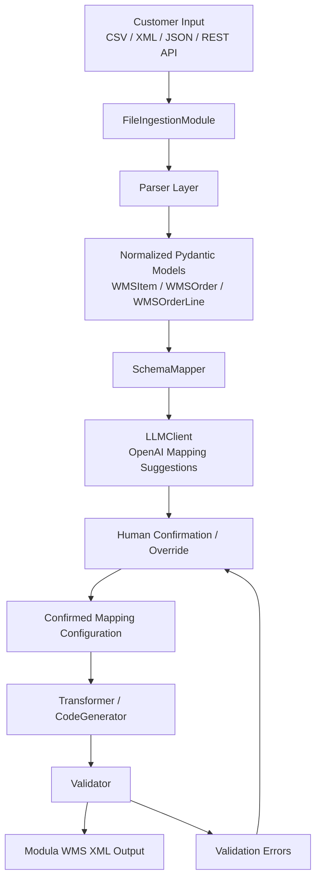

# Modula WMS Integration Agent — Component Diagram

## Architecture Notes

### FileIngestionModule
Responsible for:
- accepting uploaded files
- detecting file types
- routing to appropriate parsers

### Parser Layer
Converts external formats into normalized internal models.

Supported formats:
- CSV
- XML
- JSON
- REST API responses

### SchemaMapper
Determines how customer ERP fields map to Modula WMS fields.

### LLMClient
Uses OpenAI API to suggest field mappings and confidence scores.

### Human Confirmation / Override
Allows users to:
- approve mappings
- reject mappings
- manually correct mappings

### Transformer / CodeGenerator
Generates Modula-compatible XML output files.

### Validator
Checks:
- required fields
- data types
- XML structure
- mapping completeness